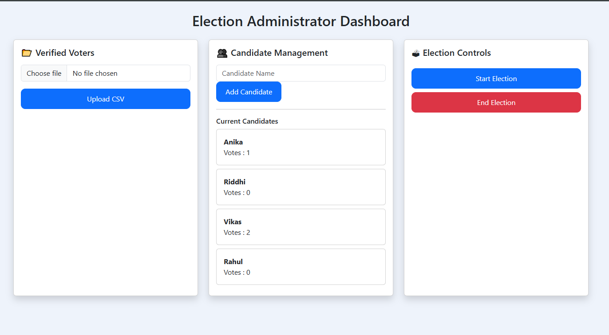
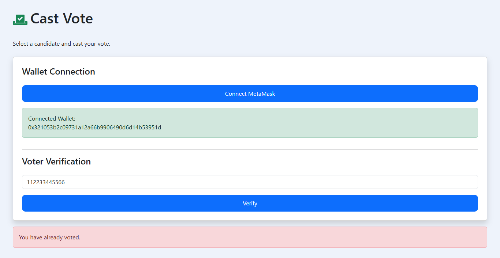
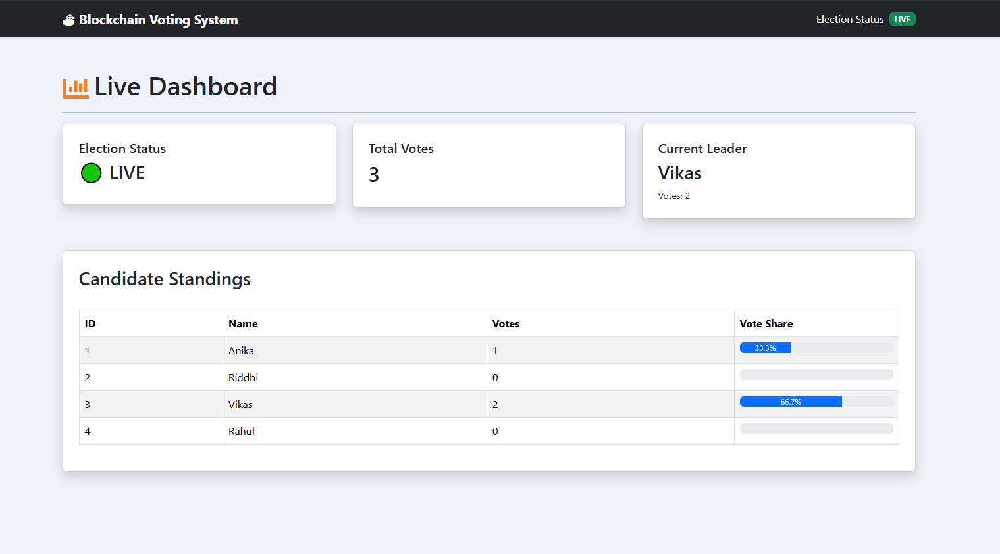
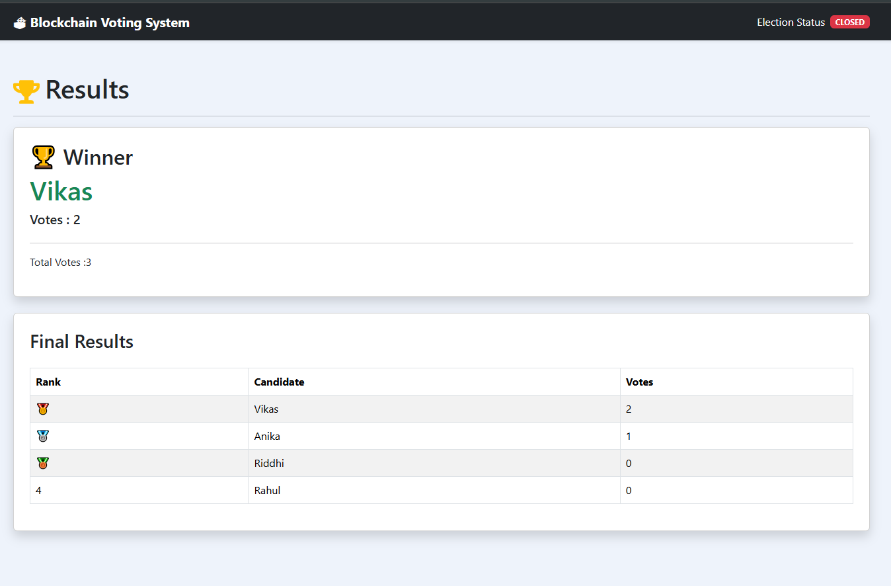

# Blockchain Voting System
A decentralized voting system built using Ethereum Blockchain, Solidity, Flask, React.js and SQLite.

## Features
- Secure voter verification
- MetaMask integration
- Blockchain vote recording
- Admin dashboard
- Live election dashboard
- Result declaration
- CSV voter import
- Duplicate vote prevention

## Tech Stack
- React.js
- Flask
- Solidity
- Hardhat
- Ganache CLI
- SQLite
- Web3.py
- MetaMask

## Project Structure
BlockchainVotingSystem
├── backend
├── frontend
├── blockchain
└── README.md

## Installation
### Clone Repository
git clone https://github.com/Anikatomar/BlockchainVotingSystem.git
cd BlockchainVotingSystem
### Backend
cd backend
pip install -r requirements.txt
python app.py
### Frontend
cd frontend
npm install
npm run dev
### Blockchain
cd blockchain
npm install
npx hardhat compile
ganache --database.dbPath ./ganache-db
npx hardhat run scripts/deploy.js --network ganache

## 📸 Screenshots
### Home Page

---
### Admin Dashboard

---
### Voting Page

---
### Live Dashboard

---
### Results
